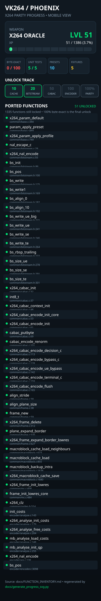

# Vk264 Phoenix



A from-scratch, function-for-function CPU port of x264. This repository **is**
the Phoenix project: the old incremental oracle and its harnesses were removed from this branch.
`vk264-phoenix` is the single, default branch; the 362 old branches were
**archived as tags** (`archive/pr<N>-<branch>` and `archive/pre-phoenix-main`)
by `tools/archive_old_branches.py`, so nothing was lost. This CPU reference is
what the eventual **shader version of Vk264** will be derived from.

## Layout

```
.                            repository root (= the old vk264-phoenix/ tree)
  CMakeLists.txt             build definition for the library + tests
  README.md                  this file
  reference/x264/            176 source files copied from the exact x264 build
                             used for all parity measurements (authoritative)
  src/                       the new oracle source (Phoenix port)
    phx_param.h/.c           x264_param_t defaults + 10 presets  [WP1 — done]
    phx_tables.h/.c          generated x264 tables (lambda, ue, chroma) [done]
    phx_cost.h/.c            analyse.c cost tables + QP init      [WP1 — done]
    phx_frame.h/.c           frame allocation + lowres planes     [WP1 — done]
    phx_mbcache.h/.c         scan8 + progressive MB cache load/save [WP2 — done]
    phx_bitstream.h/.c       bs_* Golomb writer + NAL escape        [done]
    phx_cabac.h/.c           CABAC arithmetic coder + context init  [done]
    phx_headers.h/.c         SPS/PPS init + write + NAL assembly    [20/20 exact]
    phx_slice.h/.c            slice header writer                     [done]
    phx_cabac_syntax.h/.c     CABAC MB/coeff syntax (24 golden cases) [done]
    phx_cavlc.h/.c            CAVLC residual syntax + x264 tables     [done]
    phx_predict.h/.c          46 predictors with filtered edges      [done]
    phx_dct.h/.c              DCT/Hadamard/IDCT family                [done]
    phx_quant.h/.c            deadzone quant/dequant + CQM tables     [done]
    phx_encoder.h/.c          full I-frame loop + slice/entropy      [wired]
    phx_chroma.h/.c           4:2:0 chroma DC/AC encode               [wired]
    phx_sei.h/.c               version SEI NAL (byte-exact)           [wired]
    phx_lookahead.h/.c         slicetype/scenecut state machine       [ported]
    tools/phx_cli.c            raw-YUV CLI, emits Annex-B I frames    [wired]
  tests/                     unit tests for ported functions
    test_param.c             10-preset parameter parity          [passing]
    test_cost.c              cost tables against x264 goldens    [passing]
    test_frame.c             lowres planes + border expansion    [passing]
    test_mbcache.c           scan8 + cache load/save round-trip  [passing]
    test_bitstream.c         Exp-Golomb patterns + NAL escape     [passing]
    test_cabac.c             decision/bypass vs x264 golden bytes [passing]
    tests/compare_headers.py SPS+PPS byte-exact 20/20
    tests/parse_sps.py        PPS tail oracle
    tests/compare_streams.py  100-case byte comparator
    tests/test_phx_*.c         24 registered CTest targets
  tools/
    gen_function_inventory.py   regenerate docs/FUNCTION_INVENTORY.md
    gen_tables.py              regenerate src/phx_tables.{h,c} from x264 source
    make_video_fixtures.py      crop D:\Videos MP4s into raw YUV fixtures
    parity_harness.py          100-case byte-exact x264 comparison
    nightly_gates.py           single-command full verification suite
    extended_video_probe.py    corpus clustering and first-diff report
    first_frame_probe.py       NAL/slice divergence probe
    cabac_bin_diff.py          ordered CABAC bin comparison
    run_tests.py               configure + build + ctest (CMake)
    close_branches.py          one-time branch cleanup utility
    archive_old_branches.py    one-time archival of old branches as tags
  docs/
    README.md                  mission, rules, gates
    X264_PIPELINE.md           how x264 encodes, function by function
    DATA_STRUCTURES.md         structs that must be ported, field by field
    FUNCTION_INVENTORY.md      mechanical inventory of 1386 x264 C functions + status
    ORACLE_DESIGN.md           required structure and API of the new oracle
    SHADER_MAPPING.md          CPU->shader classes A/B/C (the main goal)
    PARITY_HARNESS.md          byte-exact comparison procedure and status
    PORTING_ROADMAP.md         WP0-WP9 with acceptance gates
    FUNCTION_PORTS.md          per-function x264 source/state/shader register
    SHADER_NOTES.md            CPU->shader buffers and stage routing
    NIGHTLY_STATUS.md          gate semantics and morning workflow
    PARITY_ITERATION.md        divergence -> fix -> golden loop
    VIDEO_CORPUS.md            real-video corpus analysis
```

## Current state (measured)

| Layer | Status | Evidence |
|---|---|---|
| Repository | `vk264-phoenix` sole default branch, 362 old branches archived as tags | `git branch -a`, `git tag` |
| Reference/docs/tests | 176 x264 files, 13 docs, 27 source modules, 24 unit-test targets | `reference/x264/`, `docs/`, `src/`, `tests/` |
| Function port | **273 / 1386 PORTED (19.7%)** | `docs/FUNCTION_INVENTORY.md` |
| Unit tests | **24/24 passing** | `python tools/run_tests.py` |
| Headers | **SPS 20/20, PPS 20/20, SEI byte-exact** | `python tests/compare_headers.py` |
| MB0 entropy | **715/715 ordered CABAC bins identical** to instrumented x264 | `python tools/cabac_bin_diff.py --all` |
| Slice types | lookahead emits B/BREF with real lowres frame/path costs | `tests/test_phx_lookahead.c` |
| Encoder robustness | **100/100** cases encode with `rc=0` (crashes fixed) | `python tools/parity_harness.py` |
| Full-stream parity | **0/100 byte-exact** ? NOT achieved | `build/parity/parity_report.json` |

First divergences: synth-medium-cabac IDR slice payload byte **76** (MB1 intra4x4 mode decisions); stream byte **35?39** across the corpus. `first_frame_probe.py` shows slice headers now match for the first frame; the remaining gap is MB-level analysis/reconstruction and later P/B payload syntax.

Real-video test: two `D:\Videos` MP4s decoded to 640x360/60f YUV and encoded by x264 at `--bitrate 6000` across all 10 presets x CABAC/CAVLC ? **40/40 streams** saved in `build/video_encode_test/` (`x264_results.json`). Phoenix currently fails to open at 640x360 (`encoder open failed`); a worker is adding bitrate mode and fixing non-64x64 dimensions. On the short 60-frame clips x264's achieved average bitrate is well below 6000 kbps because ABR has not converged (e.g. 678 kbps for ultrafast/cabac).

Nightly one-command check: `python tools/nightly_gates.py` (or `--quick`), see `docs/NIGHTLY_STATUS.md`. Corpus clustering: `python tools/extended_video_probe.py`, see `docs/VIDEO_CORPUS.md`.

Next concrete targets: (1) make the 640x360/6000-kbps Phoenix test run, (2) fix MB1 mode decisions from analysis-vs-encode reconstruction, (3) finish remaining P/B slice payload fields. No case counts until every byte matches.

## Rules

1. Port x264's functions verbatim — including its data structures, tables and
   state ownership. No approximations to make a metric move.
2. Every function gets a doc comment with its x264 source lines and a
   `SHADER: A/B/C` classification (see `docs/SHADER_MAPPING.md`).
3. Every ported function gets a unit test comparing directly with x264.
4. Work packages are sequential; see `docs/PORTING_ROADMAP.md`.

## Verify

```
python tools/gen_tables.py
python tools/gen_function_inventory.py
python tools/run_tests.py
python tests/compare_headers.py
python tools/parity_harness.py
python tools/nightly_gates.py --quick
```
